# UIII ACT 6 Preparacion y evaluacion de imagenes para Vision Aritificial
## Caleb Dorado NC = 0039
# Imagenes originales de conejos + en terminal 0039

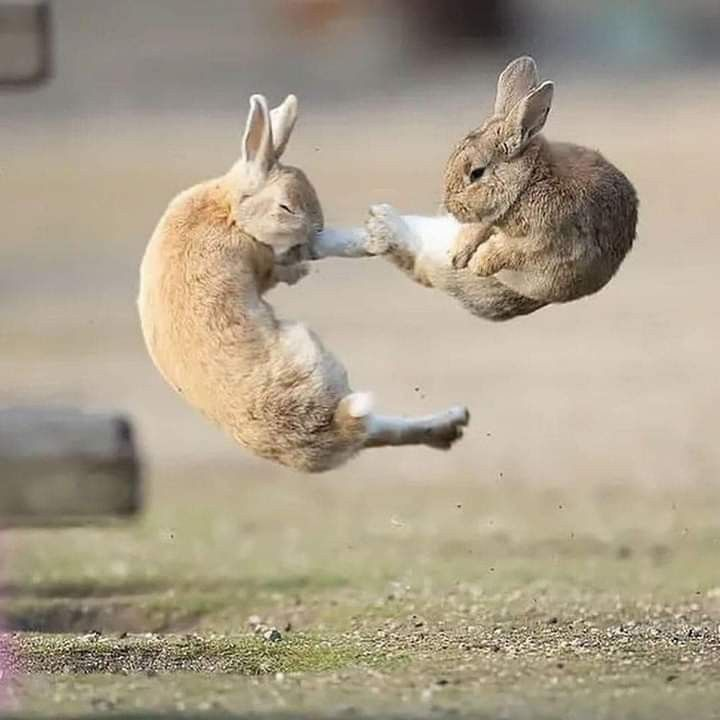
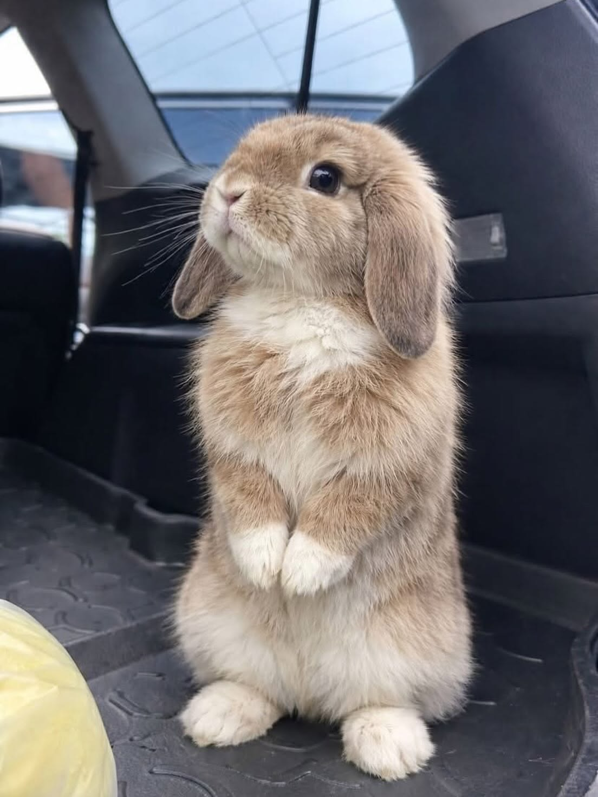

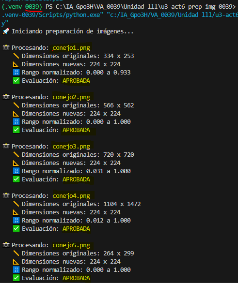
# Imagenes originales de liebres + en terminal 0039
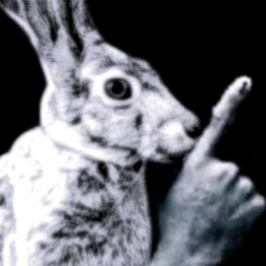
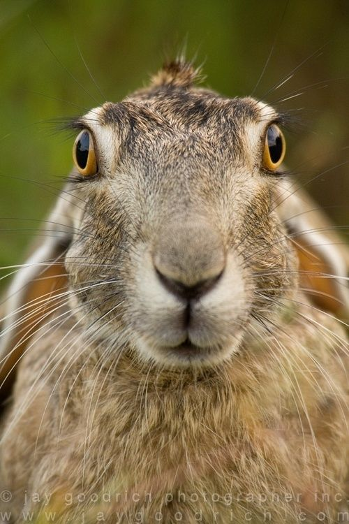

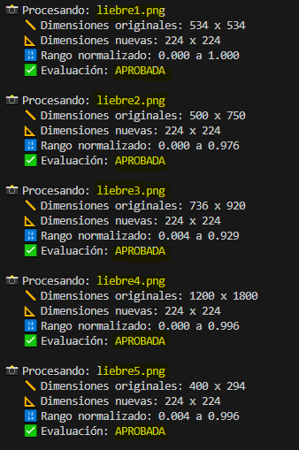

# Imagenes preparadas conejos 0039

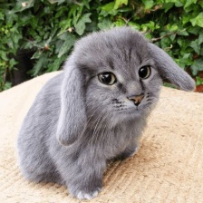

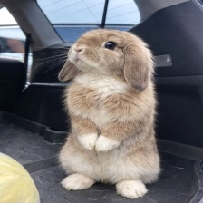
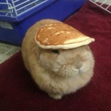

# Imagenes preparadas liebres 0039

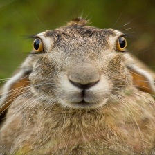
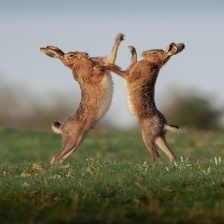
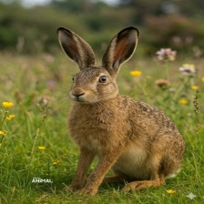
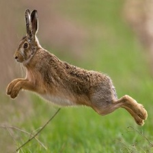